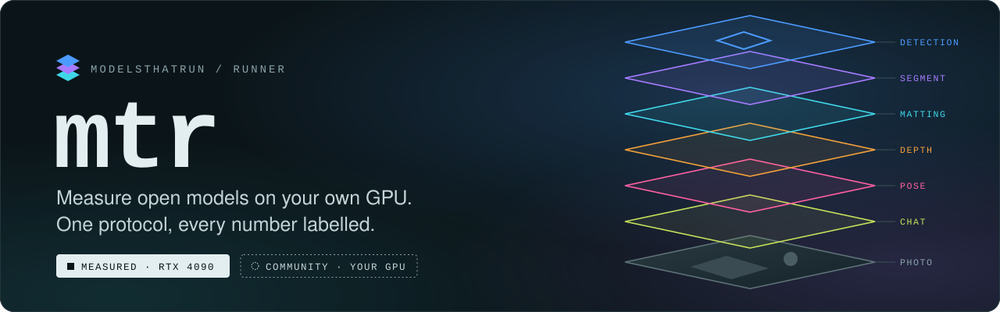
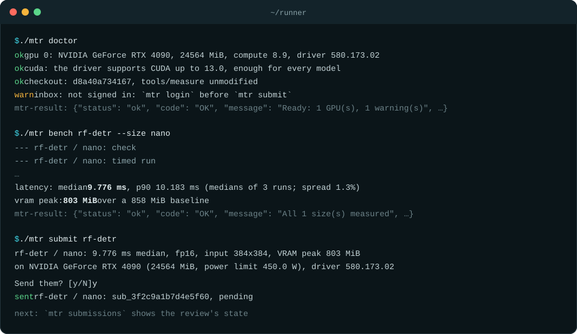
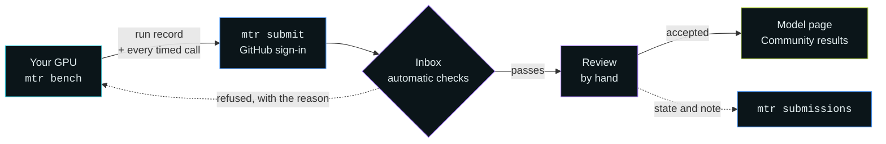

<p align="center">
  
</p>

<p align="center">
  <a href="https://github.com/modelsthatrun/runner/actions/workflows/test.yml"></a>
  <a href="LICENSE"></a>
  
  
  <a href="https://docs.astral.sh/uv/"></a>
</p>

<p align="center">
  <b>Measure open models on your own NVIDIA GPU, all by one protocol, and send the results to <a href="https://modelsthatrun.dev">ModelsThatRun</a>.</b>
</p>

<p align="center">
  <a href="#quickstart">Quickstart</a> ·
  <a href="#how-it-works">How it works</a> ·
  <a href="#what-you-can-measure">Models</a> ·
  <a href="#commands">Commands</a> ·
  <a href="CONTRIBUTING.md">Contributing</a> ·
  <a href="AGENTS.md">For AI agents</a>
</p>

---

ModelsThatRun lists open models that have public code and weights and that actually ran. For each one it gives:
- license verdicts read from primary sources
- outputs on shared test images
- speed, VRAM and accuracy, all measured by one protocol

We measure on our RTX 4090. With `mtr` you measure the same checkpoints on your GPU, and once reviewed your results show on the model's page under **Community results**, with your GitHub name.

> [!NOTE]
> The submission inbox is open, and submissions are reviewed now. The site at modelsthatrun.dev isn't public yet; accepted results appear there when it opens.

## Quickstart

```bash
git clone https://github.com/modelsthatrun/runner && cd runner
./mtr doctor                         # is this machine ready, and what will a record say about it?
./mtr models                         # what you can measure
./mtr bench rf-detr --size small     # check it, then time it (the first time also downloads its environment)
./mtr login                          # sign in with GitHub (device code in your browser)
./mtr submit rf-detr                 # shows exactly what will be sent, then asks
```

<p align="center">
  
</p>

`./mtr submissions` shows the review's state later. Every command ends with one line, `mtr-result: {…}`, that says what happened and what to do next.

> [!TIP]
> - **Running commands.** Run them from the clone as `./mtr …`. Messages and these docs write them as `mtr …`.
> - **Start small.** Begin with a model's smallest size. `mtr bench` without `--size` measures every size, and a size that doesn't fit your GPU's memory stops with `OOM`.
> - **Updating.** `git pull` brings new models and fixes. Records stay submittable after an update as long as they were measured at a commit of this repository, under the current protocol version.

## How it works



**What a timed run does.** `mtr bench` runs `mtr check` and then `mtr run` for each size.
- **`check`** downloads the weights, loads the model, makes a few calls and validates the outputs. It writes no record.
- **`run`** starts a fresh process three times, and each makes 10 warm-up calls and 100 timed calls on the task's fixed timing image. Each timed call is one `predict()`: pre-processing, the forward pass and post-processing.
- **The record** gets the median and p90 of the three runs, the VRAM peak over the idle baseline, and everything about the machine and the tool that could change the numbers.

A timed run needs a quiet machine. It refuses to start, or discards the result, when:
- another program computes on the GPU (`GPU_BUSY`)
- other programs use more than 15% of the CPU (`CPU_BUSY`)
- the three runs disagree by more than 10% (`VARIANCE`)

So close games, videos and training jobs first. The full protocol is in [docs/protocol.md](docs/protocol.md).

Results land in `models/<id>/runs/<size>.json`, with `<size>.times.json` (every timed call) and `<size>.log` next to it. Git ignores them.

**How your results show.**
- **They never replace ours.** Community results sit in their own table on the model page. Our RTX 4090 numbers, the task charts and the rankings use only our own measurements.
- **Unverified, then reproduced.** A result is *unverified* until someone else with the same GPU, size and precision gets within 10%. Then both rows are *reproduced*. A matching RTX 4090 result shows on our card as "Reproduced by N contributors".
- **Power limits are shown.** A GPU running below its default power limit is marked *power-limited*.
- **Every submission is reviewed by hand** before it shows. Nothing notifies you; `./mtr submissions` shows the state and the reviewer's note. The checks and the review are in [docs/submitting.md](docs/submitting.md).

## What you can measure

| Task | Models (sizes) |
|---|---|
| **Object detection** | `rf-detr` (4) · `yolo26` (5) · `d-fine` (5) · `deimv2` (4) · `rt-detrv4` (4) · `gtr` (4) · `grounding-dino` (2) · `mm-grounding-dino` (3) · `llmdet` (3) |
| **Instance segmentation** | `rf-detr-seg` (6) · `yolo26-seg` (5) · `gtr-seg` (4) · `eomt` (2) |
| **Image matting** | `birefnet` (3) · `ben2` (1) |
| **Depth estimation** | `moge-2` (3) · `depth-anything-v2` (1) |
| **Pose estimation** | `yolo26-pose` (5) · `gtr-pose` (4) · `rf-detr-keypoint` (1) |
| **Chat** (GGUF via llama.cpp) | `qwen3` (2) |

`./mtr models` lists the sizes and each model's CUDA version, and marks the ones your driver can't run. To add a model, see [Adding a model](#adding-a-model).

## What you need

- **Linux with an NVIDIA GPU and a recent driver.**
- **[uv](https://docs.astral.sh/uv/getting-started/installation/), any recent version.** It installs the right Python and each model's pinned environment from its committed lock, and shares packages between models.
- **git.**
- **For language models:** the CUDA toolkit (`nvcc`), CMake and a C++ compiler. The first language model builds the pinned llama.cpp for your GPU, which takes 10–15 minutes, once.
- **To submit:** a GitHub account.

> [!IMPORTANT]
> **Driver.** Each model's environment is built for one CUDA version, and the driver must support it.
> - Most models use CUDA 13.0, which needs **driver 580 or newer**. A few use CUDA 12.8 (driver 570) or 12.4 (driver 550).
> - `./mtr doctor` and `./mtr models` show what your driver can run. A model it can't run stops before anything downloads.
>
> **Disk.** The first check of a model downloads its environment.
> - PyTorch with its CUDA libraries is about 5 GB, stored once and shared by every model on the same version. Then come the weights: from tens of MB to a few GB.
> - Plan on 10–20 GB for your first model and a few GB for each one after it. `./mtr clean <model> --yes` frees them.

## What is sent, and what becomes public

`mtr submit` shows everything before it sends anything, and asks.

| | |
|---|---|
| **Sent** | The run record: the numbers, the GPU (name, driver, memory, compute capability, power limit), the CPU model, the OS, the Python, torch and package versions, the weight files' hashes, the tool's git commit and the hashes of the adapter, its lock and the input. Also the raw timings and your note. |
| **Never sent** | Images, file paths, your host name or user name. The inbox doesn't store your IP address. |
| **Public once accepted** | Your GitHub login, the GPU, the numbers and the date, on the model's page. |
| **License** | Submitted records are dedicated to the public domain ([CC0 1.0](https://creativecommons.org/publicdomain/zero/1.0/)). |

**How sign-in works.**
- `mtr login` uses GitHub's device flow.
- The inbox asks GitHub whose token it is, then forgets it and gives you its own token, valid for 90 days.
- That token is kept in `~/.config/modelsthatrun/credentials.json`, readable by you only.

## Commands

| Command | What it does |
|---|---|
| `mtr doctor` | Checks the machine: OS, driver and CUDA, GPUs, uv, git, build tools, disk, CPU load, sign-in. Changes nothing |
| `mtr models` | Lists the models, their task, CUDA version and sizes, and what you measured |
| `mtr check <model> --size <size>` | Downloads, loads and tries a checkpoint. Writes no record |
| `mtr run <model> --size <size>` | One timed measurement → `models/<id>/runs/<size>.json` |
| `mtr bench <model> [--size …]` | `check`, then `run`, for each size (or the ones named) |
| `mtr eval <model> --size <size> --benchmark <name>` | Accuracy on a standard benchmark: COCO val2017 (downloads about 1 GB once), or IFEval and GSM8K for language models. Optional, and not submitted yet |
| `mtr results` | Your records, and which can be sent or were sent |
| `mtr login` · `logout` · `whoami` | Sign in to the inbox with GitHub |
| `mtr submit <model> [--size …] [-m note]` | Sends records for review |
| `mtr submissions` | What you sent, with the review's state and note |
| `mtr queue add` · `list` · `run` · `drop` | Batches timed runs into one quiet stretch |
| `mtr new <id>` | Starts an adapter for a new model ([CONTRIBUTING.md](CONTRIBUTING.md)) |
| `mtr clean <model> --yes` | Frees the disk a model used: its environment and weights. Then runs `uv cache prune`, which tidies your whole uv cache |

`<model>` is an id such as `rf-detr`, or a model directory. `--gpu N` picks a GPU on a multi-GPU machine, and `mtr <command> --help` shows every option.

<details>
<summary><b>When something stops</b>: what each result code means</summary>

<br>

| Code | What to do |
|---|---|
| `GPU_BUSY`, `VRAM_LOW` | Another program uses the GPU. Close it and run again |
| `CPU_BUSY` | A build, download or encoder is running. Wait until the machine is quiet |
| `VARIANCE`, `DRIFT` | The runs disagreed or something disturbed them. Run again on an idle machine |
| `OOM` | It doesn't fit in your GPU's free memory at the protocol's settings. The settings are never lowered |
| `ENGINE` | llama.cpp failed to build or start. Read the build log the message names; `nvcc` must be installed |
| `WEIGHTS_MISSING` | Run `mtr check` first: it downloads the weights. For gated weights, accept the terms on Hugging Face and set `HF_TOKEN` |
| `UNSUPPORTED` | The machine lacks something: Linux, an NVIDIA driver, uv, or a driver new enough for the model's CUDA. The message names it |
| `LOCK_STALE`, `DIRTY` | Your checkout differs from the repository, so the record can't be traced to a public commit. `git stash` (or use a fresh clone), then measure again |
| `NOT_SUBMITTABLE` | The record can't be sent. The message says why; usually: measure it again with the current `mtr` |
| `AUTH` | Run `mtr login`. A sign-in lasts 90 days |

Every code and its hint are in `tools/measure/src/mtr_measure/errors.py`.

</details>

<details>
<summary><b>If your desktop streams from the measuring GPU</b>: pause hooks for Sunshine and Steam</summary>

<br>

If it runs Sunshine or Steam on the GPU you measure on, name them in `~/.config/modelsthatrun/machine.toml`:

```toml
pause = ["sunshine", "steam"]
```

Timed runs then pause them and start them again right after.
- **Sunshine:** a systemd user unit, either the Flatpak's or the `sunshine.service` the native packages install.
- **Steam:** the Flatpak or the native client.
- **Anything else:** close it before a timed run.

</details>

## Adding a model

New models come as an adapter: a short `adapter.py` that loads the checkpoint and runs one call the way its official README does, with a pinned `pyproject.toml` and `uv.lock`.
- [CONTRIBUTING.md](CONTRIBUTING.md) explains how to send one.
- [docs/adapters.md](docs/adapters.md) describes the interface.

## Working with an AI agent

[AGENTS.md](AGENTS.md) is written for coding agents (Claude Code, Codex, Cursor and others). It covers the rules, the commands and how to read results.

## License

- **The code** is [MIT](LICENSE).
- **Patches** in `models/*/fixes/` change third-party code and keep that project's license.
- **The timing image** is CC0 ([timing/README.md](timing/README.md)).
- **Submitted records** are CC0 1.0.
- **Model weights** are not part of this repository. Each has its own license, which ModelsThatRun lists per checkpoint.
